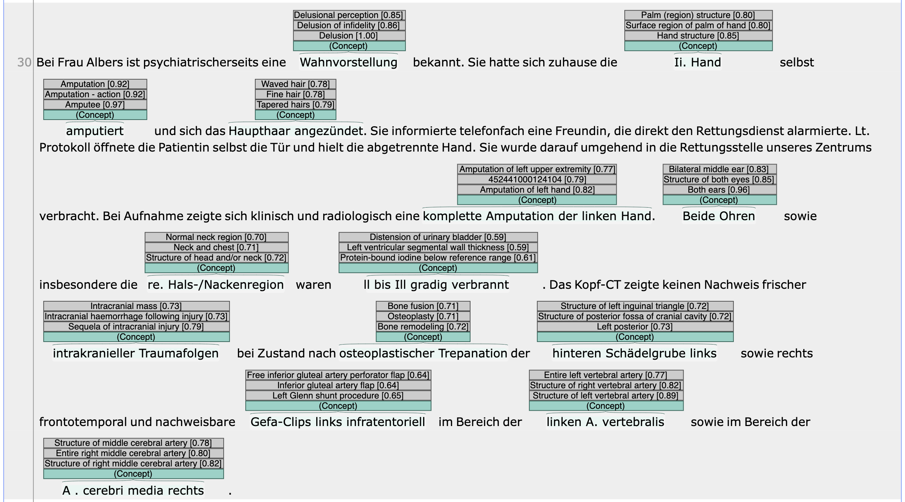

[xMEN][1] is an extensible toolkit for Cross-lingual (x) Medical Entity Normalization. 
This example shows how to use it as an [external recommender][2] in INCEpTION.

The recommender takes annotated named entity mention spans as an input and suggests a configurable number of candidate concepts from a medical terminology (like SNOMED CT). 
By default, xMEN uses an ensemble of TF-IDF vectors over character n-grams and a cross-lingual SapBERT model for candidate generation. 
This way, the recommender can be used for texts in languages other than English, even when all or most aliases from the target terminology are available in English only.

The recommender pipeline can be easily adapted to incorporate other features from xMEN, e.g., re-ranking with pre-trained or custom models, LLM-supported candidate generation, or rule-based filtering for project-specific requirements.

#### Example project

You can set this up in three easy steps:

1. Download the example project using the **Download example project** link on this page and import it

2. Download the pre-computed xMEN index for SNOMED CT (Germany) per the [instructions][2] and extract it to the current directory.

3. Run the xMEN recommender docker image: `docker run -m=12g -p 5555:5000 -v "$(pwd)"/xmen_index/index:/index/ ghcr.io/hpi-dhc/xmen-inception-recommender:main` 

Once everything is running, you can access the annotation page. 
When you create an annotation by marking a medical term in the text using the mouse, the recommender will spring into action and suggest a SNOMED-CT concept to link to the term.

The INCEpTION example project contains one document from the German-language [GraSCCo][3] corpus (synthetic clinical narrative) without annotations.

#### Importing SNOMED-CT

The project does not contain SNOMED CT as a knowledge base, so only numeric codes will be shown by default. 
If you import the SNOMED-CT terminology into the project, it will be used to resolve the concepts to their human readable names.
To get human-readable labels, add SNOMED CT as a knowledge base:

* go to the **knowledge base** panel in the project settings;
* **create** a new **local knowledge base**
* select the SNOMED-CT template, click **add**
* follow the instructions shown there for converting and importing SNOMED-Ct

If you would like to target knowledge bases, they can be easily created via the [xMEN configuration system][1].

[1]: https://github.com/hpi-dhc/xmen
[2]: https://github.com/hpi-dhc/xmen-inception-recommender
[3]: https://pubmed.ncbi.nlm.nih.gov/36073490/

#### Document sources and licenses

* `Albers.txt`: taken unmodified from the GraSCCo corpus (Graz Synthetic Clinical text Corpus,
  [doi:10.5281/zenodo.6539131](https://doi.org/10.5281/zenodo.6539131)). Licensed under the
  [Creative Commons Attribution 4.0 International](https://creativecommons.org/licenses/by/4.0/) license.
  The screenshot on this page shows an excerpt of the same document.

##### References

* L. Modersohn, S. Schulz, C. Lohr, U. Hahn.
  GRASCCO - The First Publicly Shareable, Multiply-Alienated German Clinical Text Corpus.
  Studies in Health Technology and Informatics, Volume 296, 2022, pages 66-72.
  [[PubMed](https://pubmed.ncbi.nlm.nih.gov/36073490/)]

* Florian Borchert, Ignacio Llorca, Roland Roller, Bert Arnrich, Matthieu-P. Schapranow.
  xMEN: A Modular Toolkit for Cross-Lingual Medical Entity Normalization.
  arXiv preprint (2023).
  [[online](https://arxiv.org/abs/2310.11275)]
* Florian Borchert, Ignacio Llorca, Matthieu-P. Schapranow.
  Improving biomedical entity linking for complex entity mentions with LLM-based text simplification.
  Database, Volume 2024,
  [[online](https://doi.org/10.1093/database/baae067)]

